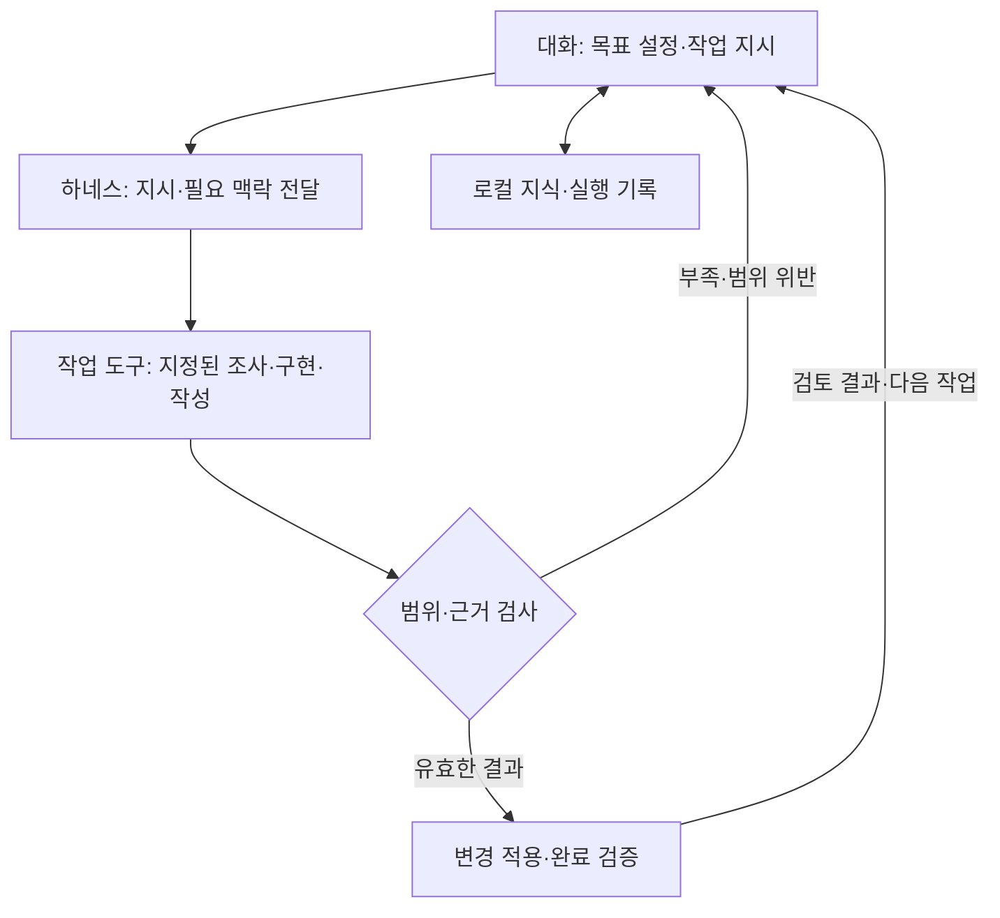

# loop-dev

**목표를 말하면 맥락을 복원하고, 작업을 수행하고, 결과를 확인해 기록하는 Claude Code·Codex 공통 하네스**입니다.

스킬을 한 번 시작하면 **해당 대화의 모든 후속 입력**에 하네스를 적용합니다.
작업은 **목표 설정 → 작업**으로 진행합니다. 개발은 구현·테스트·독립 검토·수정을 반복하고,
문서·설명·조사·계획은 결과를 작성해 완료 조건을 확인합니다. 에이전트가 실행 상태와 로컬 지식을
관리하므로 사용자가 코드 구조, 이전 답변, 다음 행동을 프롬프트마다 다시 설명할 필요가 없습니다.

## 시작

공통 환경은 macOS/Linux, Python 3.10+, Git입니다. Windows는 WSL을 사용합니다.
실제 작업은 로그인된 Claude Code 또는 Codex CLI에 위임합니다. 개발은 독립 검토를 위해
두 CLI와 대상 Git 저장소가 필요합니다. 문서·설명은 일반 디렉터리에서 작업 CLI 하나로 수행합니다.

```sh
git clone https://github.com/minjoonchoi/loop-dev.git
python3 loop-dev/scripts/install.py --target /absolute/path/to/project
```

대상 디렉터리에서 스킬을 **처음 한 번** 명시적으로 실행합니다. 목표를 같이 적어도 됩니다.

| 환경 | 시작 입력 |
| --- | --- |
| Claude Code | `/loop-dev 메모를 저장하고 조회하는 CLI를 만들어 줘` |
| Codex | `$loop-dev 메모를 저장하고 조회하는 CLI를 만들어 줘` |

이후에는 “저장 방식을 설명해 줘”, “다른 폴더의 README도 고쳐 줘”처럼 평소대로 요청합니다.
**목표 완료·새 목표·문서나 설명 요청·폴더 이동 후에도 활성화는 유지**됩니다. 진행 질문,
정정, 작업 중지 요청도 같은 하네스가 해석합니다. 단순 확인·진행 질문은 새 작업을 만들지 않습니다.
“이 작업 멈춰”는 작업을 멈추고, “하네스 꺼”는 해당 대화의 자동 처리를 끕니다.
다른 대화에는 자동 적용하지 않습니다. 다시 켜면 같은 대화의 세션과 기록을 이어갑니다.

| 상황 | 하네스 상태 |
| --- | --- |
| 새 대화에서 일반 요청 | 비활성 |
| 스킬 명시적 호출 | 현재 대화 활성화 |
| 목표 완료·새 요청·종류/경로 변경·맥락 압축 | 활성 유지 |
| 작업 일시 중지 | 활성 유지; 요청한 작업은 중지 |
| 명시적 하네스 종료 | 비활성; 목표·지식·실행 예산 보존 |

설치된 스킬과 진입 규칙을 따르는 대화 모델이 **의도와 명시적인 제한**으로 요청을 분류합니다.
로컬 세션 상태를 매 입력마다 확인하며, 메시지를 가로채는 전역 훅이나 키워드 파서는 없습니다.
Claude는 `disable-model-invocation: true`, Codex는 `allow_implicit_invocation: false`로
최초 자동 호출을 끕니다. 이 설정은 활성화 이후의 대화 규칙을 해제하지 않습니다.

설치는 `.claude/skills/loop-dev/`·`.agents/skills/loop-dev/`에 같은 공통 스킬을 등록하고,
기존 `AGENTS.md`·`CLAUDE.md`에 관리 블록만 추가합니다. 기존 지침·다른 스킬·설정은 보존합니다.
로컬에서 수정한 관리 파일은 덮어쓰지 않습니다. 폴더 이동 시 에이전트가 원래 실행 파일의
절대 경로와 세션 ID를 유지하므로 재호출할 필요가 없습니다.

## 두 단계의 역할

| 단계 | 대화가 관리하는 일 | 사용자가 하는 일 |
| --- | --- | --- |
| 목표 설정 | 지식·이전 답변 확인, 조사 위임, 결과·범위·완료 조건 구체화 | 목표 전달; 해결되지 않은 사용자 결정에만 답변 |
| 작업 | 범위를 정해 도구에 위임, 결과 확인, 관련 지식 갱신, 결과 보고 | 결과 확인 |

명확한 요청은 내부적으로 목표를 정한 뒤 바로 진행합니다. 목표 설정이 매번 질문이나 승인을
받는 단계는 아닙니다. 현재 구현 수준은 원하는 목표 수준을 낮추는 근거가 아닙니다.
작업 시작 뒤에는 합의한 범위에서 질문 없이 진행합니다. 외부 장애나 권한 부족으로 끝낼 수
없으면 원인과 미완료 범위를 기록하며 성공으로 표시하지 않습니다.

| 작업 유형 | 수행과 완료 확인 |
| --- | --- |
| 개발 | 사전 교차 검토 → 목표·규칙 고정 → 구현·테스트·반대 도구 검토·수정 → 전체 최종 검증 |
| 문서·설명 | 작성·설명 후 내용과 전달물 조건 확인 |
| 조사·읽기 전용 검토 | 근거 조사 후 결론·불확실성·범위 확인 |
| 계획 | 실행 없이 계획과 요청한 판단 기준 확인 |

비개발 작업에 정해진 반복 횟수나 교차 검토를 강제하지 않습니다. 실제 오류나 누락은 수정합니다.
여러 저장소의 개발은 같은 세션에 연결한 저장소별 목표로 수행하고, 필요한 통합 검증까지 완료해야 합니다.

## 대화와 작업 도구의 경계



| 담당 | 책임 |
| --- | --- |
| 대화 | 목표와 결정 정리, 작업 분해, 명시적인 위임, 결과 확인과 다음 지시 |
| 작업 도구 | 전달받은 범위의 조사·계획·구현·문서 작성; 부족한 입력은 장애로 반환 |
| 하네스 | 결과 형식·수정 경로·원본 해시 검사, 수정안 적용, 테스트·독립 검토 실행, 기록 저장 |

위임은 **목적·읽을 범위·수정할 파일·금지 사항·산출물·완료 조건**을 갖습니다. 필요한 현재 지식과
선행 작업 결과만 선택해 전달합니다. 작업 도구는 목표를 확장하거나 다른 도구에 재위임하지 않습니다.
읽기 전용 CLI가 수정안을 반환하고 하네스가 검증 후 적용합니다. 도구의 `done`은 맡긴 작업의
완료이며, 개발 전체 완료는 기존 게이트가 판정합니다. 문서·설명은 내용·완료 조건 확인을 거칩니다.

지시의 범위와 공급자 권한은 읽기 동작을 제한하며, 파일별 OS 격리를 제공하는 것은 아닙니다.
실제 적용되는 수정은 정확한 허용 경로와 원본 해시로 검사합니다. 자세한 계약은
[위임 규칙](rules/delegation.md)을 따릅니다.

## 다시 설명하지 않아도 이어지는 지식

로컬 지식베이스는 프로젝트, 작업 위치, 세션, 작업 이력을 연결합니다. 같은 Git origin의 여러
체크아웃은 프로젝트를 공유하지만 파일 상태는 각각 확인합니다. 관계없는 프로젝트의 분석과
한 번만 허용한 결정은 다른 작업에 자동 적용하지 않습니다.

- 새 요청 전에 유효한 분석·답변을 읽고, 빠진 정보와 관련 변경만 조사합니다.
- 파일 수정·추가·삭제·이름 변경, 규칙·브랜치 변경으로 영향을 받은 지식을 재확인 대상으로 표시합니다.
- 에이전트가 변경을 조사한 뒤 해당 항목을 갱신합니다. 조회만으로 오래된 결론을 최신으로 만들지 않습니다.
- 확정 사실·초안·가설·과거 결과를 구분합니다. 과거 성공 기록은 현재 검증이나 새로운 권한을 대신하지 않습니다.

기본 위치는 `~/.local/share/loop-dev/`이며 `LOOP_KB_HOME` 또는 `--knowledge-home`으로
변경할 수 있습니다. 프로젝트 밖에 두며 전역 공급자 설정을 수정하지 않습니다.
세션 ID와 저장 명령은 에이전트가 관리합니다.

## 읽기 쉬운 실행 기록

실행 상태는 **목표·현재 단계·근거·다음 행동/장애**로, 지식은 **결론·적용 범위·상태·근거**로 작성합니다.
필요하면 이유, 세부사항, 불확실성만 추가합니다. Markdown은 저장된 구조화 데이터에서 생성하므로
에이전트와 사람이 서로 다른 요약을 읽지 않습니다.

요약은 한 줄 280자 이내이며 선택적인 세부사항은 최대 다섯 개입니다. 긴 설명과 모든 근거는
연결된 전달물·JSON에 보존합니다. 중복 내용, 임시 문구, 과도하게 긴 요약은 저장 단계에서 거절합니다.
변화 없는 기록은 새 버전으로 쌓지 않고, 목록은 개수·검색·페이지로 탐색합니다.
문장 의미와 근거의 정확성은 에이전트가 확인합니다. 길이 검사만으로 글의 품질을 보장하지 않습니다.

출력 원칙은 [ELI5](https://github.com/DreambigOu/ELI5)와
[i-have-adhd](https://github.com/ayghri/i-have-adhd)를 참고했습니다.
적용 기준은 [작성 규칙](rules/writing.md)에 있습니다.

## 내부 명령과 저장 위치

하네스 운영 명령은 에이전트가 실행합니다. 설치된 프로젝트는 `python3 .loop/loop.py`, 이 저장소는
`python3 scripts/loop.py`를 사용합니다. 사용자가 JSON이나 ID를 직접 관리할 필요는 없습니다.

| 용도 | 명령 |
| --- | --- |
| 세션 활성화 | `harness on`, `harness status`, `harness off` |
| 공통 작업 | `work open`, `work goal`, `work start`, `work delegate`, `work context`, `work finish` |
| 지식 재사용·갱신 | `knowledge context`, `knowledge remember`, `knowledge get`, `knowledge history` |
| 프로젝트 연결 | `knowledge projects`, `knowledge attach` |
| 개발 | `init`, `delegate`, `validate`, `doctor`, `plan-review`, `freeze`, `start`, `checkpoint`, `finish` |
| 하네스 자체 평가 | `bench check`(전체 실행), `bench plan`, `bench run`, `bench judge`, `bench report`, `bench gate`, `bench proposal` |
| 맥락·복구 | `context`, `status`, `note`, `block`, `resume`, `abort`, `session`; 공통 작업은 `work` 하위 명령 |

| 위치 | 내용 |
| --- | --- |
| `.agents/skills/loop-dev/`, `.claude/skills/loop-dev/` | 환경별 명시적 스킬 진입점 |
| `.loop/goals/<id>/` | 개발 목표와 최초 진단; Git 포함 권장 |
| `.loop/state/<id>/` | 개발 상태·검증 로그·맥락·`status.md`; Git 제외 |
| `.loop/state/sessions/` | 개발 세션의 분석과 이전 답변; Git 제외 |
| `LOOP_KB_HOME/knowledge.sqlite3` | 세션 활성화·공통 지식·프로젝트·작업·위임·실행 예산 및 이전 버전 |
| `.loop/state/<id>/delegations/`, `LOOP_KB_HOME/runs/` | 각각 개발·공통 작업의 지시, 결과, 원본과 로그 |
| `LOOP_KB_HOME/views/` | 같은 기록에서 생성한 Markdown과 JSON 뷰 |

공통 `work finish`로 개발 게이트를 우회할 수 없습니다. 개발 완료에는 실제 검사와 새로운
독립 검토가 필요하며, 소스·목표·규칙 변경으로 이전 증거가 만료됩니다. 커밋·병합·배포는 완료
판정의 자동 부작용이 아닙니다. 사전에 허용된 전달 범위에 따라 에이전트가 수행합니다.

배경 데몬은 없습니다. 요청·맥락 조회·작업 전환 때 기록을 확인하고 갱신합니다. 호스트가 종료되면
보존된 상태에서 재개합니다. 다른 컴퓨터에서는 필요한 로컬 상태를 의도적으로 옮겨야 합니다.

## 하네스가 실제로 더 나은지 평가

벤치는 같은 요청을 **하네스 미사용 / 현재 하네스 사용** 두 조건으로 반복 실행합니다.
같은 모델·effort·초기 파일·예산을 사용하고, 대화·지식베이스·작업 공간을 각각 분리합니다.
기능은 외부 검사로, 문서·설명은 익명 결과물의 기준별 평가로 확인합니다.
완료 선언이나 작업량 자체에는 점수를 주지 않습니다.

특정 과제의 품질 저하, 추가 사용자 질문, 과도한 시간 증가를 발견하면 통과를 막습니다.
**개선 / 회귀 없음 / 회귀 / 근거 부족**을 구분하고, 실패 근거와 관련 규칙을 연결해
변경 가설을 저장합니다. 규칙 변경 후 같은 기준으로 재측정하며, 코드나 평가 기준이
바뀌면 이전 통과 결과가 만료됩니다.

터미널에서 Claude와 Codex의 모델·effort를 각각 지정하면 한 명령으로 비교 실행·결과물 채점·게이트·
개선 리포트까지 생성합니다. **서로 다른 목표 유형을 2개 이상** 평가해야 하며, 기본은
개발·문서·설명입니다. 같은 유형의 사례만 여러 개 넣으면 실행 전에 거절합니다.

```sh
python3 scripts/benchmark.py \
  --claude-model "$BENCH_CLAUDE_MODEL" --claude-effort "$BENCH_CLAUDE_EFFORT" \
  --codex-model "$BENCH_CODEX_MODEL" --codex-effort "$BENCH_CODEX_EFFORT"
```

대화 세션을 열거나 스킬을 미리 켤 필요가 없으며, 커밋 SHA도 입력하지 않습니다.
현재 파일을 복사해 실행하고 변경 여부 확인용 해시는 자동 저장합니다.
`--dry-run`은 실행 조건과 예산만 확인합니다. `improvements.md`에는 유형별 판정과
우선 개선할 항목을, `improvements.json`에는 측정 근거·원인 가설·변경 범위·재검증 조건을
저장합니다. 모델 비교는 같은 공통 평가자로 채점합니다.

벤치 요청과 실행 방법, 대표 과제, 판정의 한계는 [벤치마크 안내](docs/benchmark.md)에 있습니다.
실제 모델 호출이 필요한 기능이며, 아래 단위 테스트의 성공은 품질 우위를 입증하지 않습니다.

## 개발 및 검증

```sh
python3 -m unittest discover -s tests -v
git diff --check
```

외부 패키지 없이 임시 Git 저장소와 **가짜 Claude/Codex CLI**로 게이트, 복구, 지식 재사용, 문서 생성,
설치, 세션 활성화 유지·분리, 위임 범위·수정 적용, 벤치 비교 실행·회귀 판정을 검증합니다.
실제 계정의 모델 호출 품질은 검증하지 않습니다.
시작 전 읽기 전용 분석 위임으로 작업 CLI를, 개발 `plan-review`로 검토 CLI를 확인합니다.
호스트가 중첩 CLI 실행을 금지하면 제한을 우회하지 않고 시작 전에 해결하거나 장애로 기록합니다. CI는 macOS/Linux × Python 3.10/3.12입니다.

- [공통 작업과 지식 운영](docs/knowledge.md)
- [설계와 상태 전이](docs/architecture.md)
- [개발 계약과 질문 정책](docs/contract.md)
- [개발 운영·검증·장애 대응](docs/operations.md)
- [하네스 품질 벤치마크](docs/benchmark.md)
- [공통 진입 규칙](rules/work.md)
