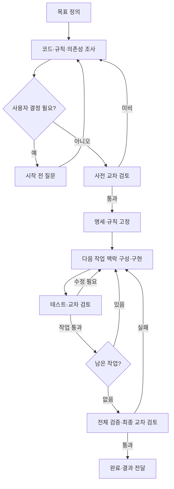

# loop-dev

목표를 전달하면 **필요한 맥락을 스스로 수집하고, 요구사항 구체화부터 구현·검토·수정·완료 검증까지 이어가는 개발 하네스**입니다.

Claude Code와 Codex의 대화에서 시작합니다. 현재 대화의 에이전트가 개발을 진행하고,
상대 CLI가 독립적으로 검토합니다. Python 스크립트가 상태·검증 결과·실행 한도를 관리하며,
두 환경은 같은 규칙과 목표 명세를 사용합니다.

## 사용자가 하는 일

1. 달성할 목표와 제약을 전달합니다.
2. 시작 전에 사용자만 결정할 수 있는 업무 규칙·범위 질문에 답합니다.
3. 구현 결과와 검증 근거를 확인합니다.

소스 위치, 현재 동작, 누락된 연결, 오류 원인, 다음 작업을 하나씩 프롬프트로 설명하는 일은
하네스 루프가 맡습니다. 현재 코드가 없거나 일부만 구현돼 있어도 목표 수준은 유지됩니다.

## 빠른 시작

필요한 환경: **macOS/Linux, Python 3.10+, Git, 로그인된 Claude Code·Codex CLI**.
Windows는 WSL을 사용합니다. 실행할 프로젝트는 Git 저장소여야 하며 초기 커밋은 없어도 됩니다.

```sh
git clone https://github.com/minjoonchoi/loop-dev.git
python3 loop-dev/scripts/install.py --target /absolute/path/to/project
```

대상 프로젝트에서 Claude Code 또는 Codex를 열고 **원하는 결과만** 전달합니다.

> 메모를 저장하고 다시 조회할 수 있는 CLI를 만들어 줘.

이런 일반적인 개발 요청 자체가 시작 조건입니다. 설치된 진입 규칙이 개발 요청에
하네스를 기본 적용합니다. 사용자가 `loop-dev`를 부르거나 “조사해 줘”, “질문해 줘”,
“검토하면서 끝까지 진행해 줘” 같은 수행 절차를 반복해서 지시할 필요가 없습니다.

에이전트가 목표·코드·규칙을 분석하고 필요한 질문을 모아서 합니다. 답변으로 구현 가능한
수준이 되면 사전 교차 검토를 거쳐 목표를 고정하고, 이후에는 질문 없이 개발 루프를 수행합니다.
사용자가 JSON을 작성하거나 아래 내부 명령을 순서대로 운영할 필요는 없습니다.
기존 작업에 대한 후속 요청은 저장된 상태에서 이어갑니다. 설명·질문·읽기 전용 검토나
“계획만 세워 줘”라는 요청은 해당 범위에서 처리하고 개발 실행을 새로 시작하지 않습니다.

설치는 기존 `AGENTS.md`와 `CLAUDE.md`를 보존하고 관리 블록만 추가합니다.
같은 버전의 재설치는 동일한 결과를 유지하며, 하네스 파일의 로컬 수정은 덮어쓰지 않습니다.
전역 설정이나 훅을 변경하지 않습니다.

## 실행 흐름



각 단계는 다음 정보를 이어받습니다.

| 정보 | 역할 |
| --- | --- |
| 목표 명세 | 원하는 결과·요구사항·인수 조건·결정·실행 한도 |
| 코드베이스 진단 | 현재 구현 수준과 요구사항별 부족한 부분 |
| 자동 맥락 파일 | 파일 목록·규칙·빌드 명세·진행 상태·최신 실패·다음 행동 |
| 실행 메모 | 새로 발견한 기술 사실, 근거, 목표 내 구현 방안 변경 |
| 검증 기록 | 실제 실행 명령·종료 코드·로그·상대 도구의 검토 결과 |

세션이 길어지거나 끊겨도 같은 목표의 맥락 파일을 읽고 이어갑니다.
실행 중에는 목표·규칙·인수 조건을 낮추거나 바꾸지 않습니다.

## 구현된 보장과 경계

- 모든 요구사항이 인수 조건·검증 명령·마일스톤으로 연결되어야 시작할 수 있습니다.
- 사전 검토, 마일스톤별 검토, 최종 검토를 **항상 반대 도구**로 실행합니다.
- 테스트 실패, 검토 지적, 검토 누락·잘못된 JSON·타임아웃은 통과할 수 없습니다.
- 최종 완료는 현재 코드에 대한 전체 테스트와 새로운 전체 검토로만 판정합니다.
- 목표·규칙·엔진 변경, 검토 중 코드 변경, 완료 이후 변경으로 오래된 증거를 재사용하지 않습니다.
- 명령은 대화형 입력 없이 실행되며 시간·재시도 한도와 중단 후 재개 상태를 기록합니다.
- 외부 권한·인증·서비스 장애 등으로 완료할 수 없으면 미완료 원인과 재개 조건을 기록합니다.

규칙은 부모 대화 에이전트의 행동을 지시하고, 스크립트는 게이트와 기록의 일관성을 강제합니다.
부모 대화의 모든 파일 편집을 OS 수준에서 차단하는 장치는 아닙니다. 호스트의 권한 정책은 유지합니다.
인증·연결·허용된 작업 범위가 충족되지 않으면 완전한 완료를 보장할 수 없으며 성공으로 표시하지 않습니다.

## 내부 명령

아래 명령은 대화 에이전트가 사용합니다. 저장소 자체에서는 `.loop/loop.py` 대신 `scripts/loop.py`를 사용합니다.

| 명령 | 동작 |
| --- | --- |
| `init ID --title TITLE --implementer claude\|codex` | 목표 초안과 진단·상태 생성 |
| `context ID` / `status ID` | 최신 맥락과 다음 행동 갱신·조회 |
| `validate ID` | 명세 완결성과 요구사항 연결 검증 |
| `doctor ID` | 두 CLI 설치·버전 확인 |
| `plan-review ID` | 실제 상대 CLI로 사전 검토·인증/연동 확인 |
| `freeze ID` / `start ID` | 통과한 명세 고정 / 구현 시작 |
| `checkpoint ID --milestone M1` | 다음 작업의 테스트와 독립 검토 |
| `note ID --kind discovery\|decision\|replan --text TEXT --evidence REF` | 조사 결과·결정·재계획 근거 누적 |
| `finish ID` | 전체 테스트와 전체 검토 후 완료 판정 |
| `block ID --reason TEXT` / `resume ID` | 장애 기록 / 같은 기준으로 재개 |
| `abort ID --reason TEXT` | 코드·증거를 보존하고 목표 종료 |

`context`가 반환하는 파일을 읽어야 상세 맥락을 볼 수 있습니다. 초기 코드·규칙 조사와
요구사항 작성은 대화 모델이 수행하며, 정적 파일 목록만으로 자동 판단했다고 간주하지 않습니다.
배경 데몬이 계속 실행되는 구조는 아니므로 호스트 세션 종료 후에는 같은 목표로 재개해야 합니다.

## 저장 구조

| 위치 | 내용 | Git 관리 |
| --- | --- | --- |
| `.loop/loop_dev/`, `.loop/loop.py` | 공통 게이트 엔진 | 포함 |
| `.loop/rules/` | 실행·맥락 수집·품질 규칙 | 포함 |
| `.loop/templates/` | 목표·진단 예시 | 포함 |
| `.loop/goals/<id>/` | `contract.json`, `discovery.json` | 포함 권장 |
| `.loop/state/<id>/` | 상태·동결 사본·맥락·검증 로그·이벤트 | 제외 |

목표와 규칙에 자격 증명을 저장하지 않습니다. 실행 상태는 해당 프로젝트의 로컬 파일로
보존되므로 다른 컴퓨터로 이어갈 때는 의도적으로 상태도 함께 옮겨야 합니다.

## 개발 및 검증

```sh
python3 -m unittest discover -s tests -v
```

외부 패키지가 필요 없습니다. 테스트는 임시 Git 저장소와 **가짜 Claude/Codex CLI**로
성공·실패·복구·검토 거절·설치 보존을 검증합니다. 모델 응답의 품질이나 실제 계정 연동을
테스트한 것으로 간주하지 않습니다. 첫 실제 사용 시 `plan-review`가 해당 환경의 연동을 검증합니다.
GitHub Actions에는 macOS/Linux × Python 3.10/3.12 검증을 구성했습니다.

- [설계와 상태 전이](docs/architecture.md)
- [계약 형식과 질문 정책](docs/contract.md)
- [운영·검증·장애 대응](docs/operations.md)
- [공통 실행 규칙](rules/workflow.md)
- [목표 명세 예시](templates/contract.example.json)
